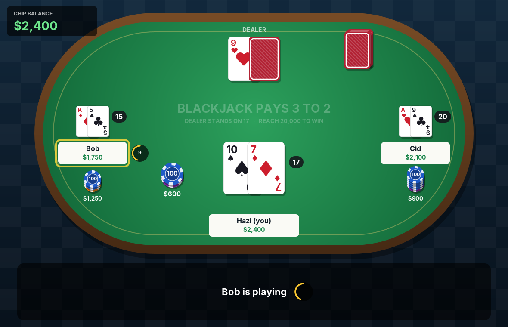
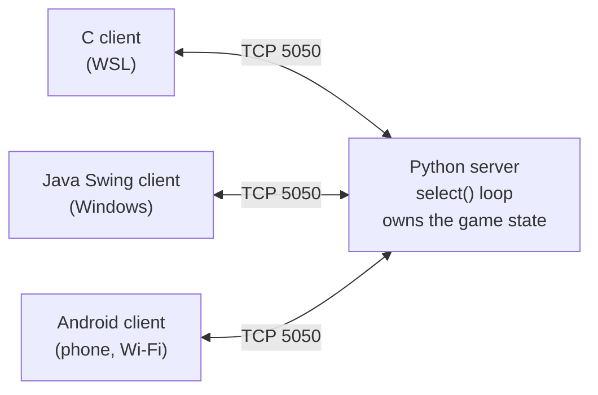

# Blackjack over TCP

Multiplayer Blackjack over raw TCP: **one single-threaded Python server** (`select()` multiplexing) hosts players from **C on Linux, Java on Windows and Kotlin on Android**.



| Program | Language | Runs on | Networking |
|---|---|---|---|
| Server (dealer) | Python 3 | Windows | `select.select()` multiplexing, raw sockets |
| Console client | C | Linux (WSL Ubuntu) | POSIX sockets, `fork()`: one process reads the server, one reads the keyboard |
| GUI client | Java (Swing) | Windows | `java.net.Socket`, reader thread |
| Mobile client | Kotlin (Jetpack Compose) | Android 17 | `java.net.Socket`, reader thread + sender executor |

Built as a solo project for the Computer Networks course at Babeș-Bolyai University, Cluj-Napoca.

## Architecture



- **Authoritative server, thin clients.** The deck, hands, bets, bankrolls, turn order and timers live only on the server. Clients send intents (`BET 500`, `HIT`) and draw what the server tells them, so a modified client cannot cheat.
- **One process, no threads on the server.** A single `select()` loop serves every client. Its timeout drives the turn timers and the pause between rounds, so the server never blocks on a slow player.
- **TCP is a stream, not messages.** Every receiver keeps a buffer and splits it on `\n`, because one `recv()` can hold half a message or several.

## Three ways to handle concurrent I/O

The project uses all three classic models, one per component:

| Model | Where | How |
|---|---|---|
| **I/O multiplexing** | Server | One thread, one `select()` loop over every socket; its timeout drives the turn timers. No locks needed, because only one thing happens at a time. |
| **Processes** | C client | `fork()` after `connect()`: the child blocks on `recv()`, the parent blocks on the keyboard; both share the socket. |
| **Threads** | Java & Android clients | A background reader thread loops on `readLine()` and hands each line to the UI thread (`invokeLater` / `Handler`). Android also sends from a separate thread, because it forbids network calls on the UI thread. |

## Game rules

- Every player starts with **3,000**; minimum bet **100**, bets in multiples of 10.
- Players bet, then hit or stand **one at a time**, each with a **20-second** turn timer (timeout: sit out / auto-stand).
- Dealer draws to 17. Blackjack pays 3:2.
- Reach **20,000** and you can cash out to lock in the win, or keep playing and risk it.
- Bankrupt players become spectators. When no active players are left, the match ends: the cashed-out players win, otherwise **the dealer wins**.

## Protocol

One message per line, ending in `\n`.

**Client → server:** `NAME <name>` · `BET <amount>` · `HIT` · `STAND` · `SPECTATE`

**Server → client:**

| Message | Meaning |
|---|---|
| `WELCOME <bankroll> <name>` | joined; the server may adjust the name (duplicates, symbols) |
| `YOUR_BET <min> <seconds>` | your turn to bet |
| `BANKROLL <n>` | bet accepted |
| `HAND <cards> <value>` / `DEALER <cards> <value>` | cards like `AS,10H`; hidden card `??` |
| `TURN <seconds>` / `DONE` | your hit/stand turn starts / ends |
| `RESULT <WIN\|LOSE\|PUSH\|BLACKJACK> <bankroll>` | round result |
| `TABLE <phase> <current> <seconds_left> <total>` + `SEAT ...` lines | snapshot of the whole table for GUI clients |
| `SPECTATING` · `GAME_OVER <DEALER\|names>` · `MSG <text>` · `ERROR <text>` | |

## Running it

**Server** (Windows, Python 3):
```powershell
python server/server.py
```
Allow TCP 5050 through the Windows firewall (admin PowerShell):
```powershell
New-NetFirewallRule -DisplayName "Blackjack 5050" -Direction Inbound -Protocol TCP -LocalPort 5050 -Action Allow
```

**C client** (WSL / Linux):
```bash
gcc -Wall -o client clients/c/client.c
./client $(ip route show default | awk '{print $3}') 5050 Alice
```

**Java client** (JDK 11+, no build step):
```powershell
java clients/java/BlackjackClient.java
```

**Android client:** open `clients/android` in Android Studio and run it on a phone on the **same Wi-Fi** as the server; connect to the PC's Wi-Fi IPv4 (`ipconfig`), port 5050.

## Things that went wrong (and what they taught me)

- **A frozen client could freeze the whole server.** `sendall()` blocks once a client stops reading and its buffer fills. Fixed with a send timeout: the socket is shut down, `select()` reports it, and it's removed like any disconnect.
- **`"²".isdigit()` is `True` in Python, but `int("²")` throws**, so one typed bet could crash the server for everyone. Now validated with `isdecimal()`.
- **The phone couldn't connect, and nothing was wrong with the network.** Firewall rule present, same subnet, ping fine, and a packet capture (`pktmon`) showed zero packets arriving from the phone. The cause: **Android 17 blocks apps targeting SDK 37 from reaching local-network addresses** unless the user grants `ACCESS_LOCAL_NETWORK`; the connection simply times out.

## Credits

The networking follows the examples of Lect. Dr. Radu Dragoș (Babeș-Bolyai University): the server is built on his Python `select` multiplexed chat server, and the C client on the `fork()` structure of his chat client.
